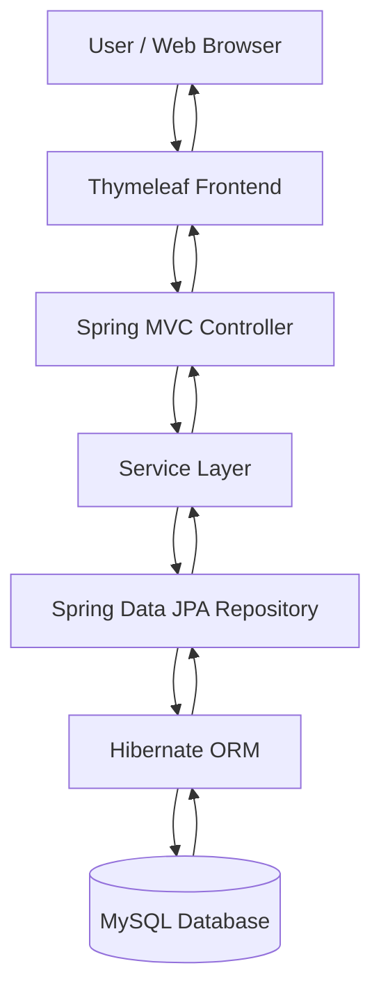
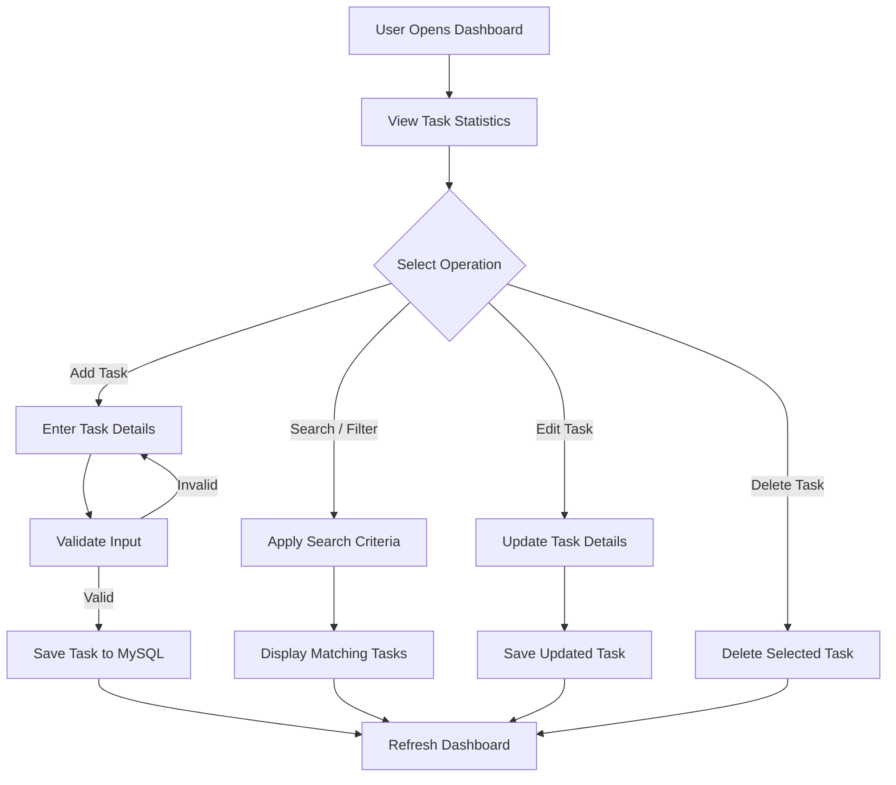

# TaskTrack – Personal Task Management System

<div align="center">

### A Simple and Efficient Task Management Application

**Organize Tasks • Track Progress • Manage Priorities • Meet Deadlines**


</div>

---

## Overview

**TaskTrack** is a web-based Personal Task Management System developed using Java and Spring Boot. It provides a centralized platform for creating, organizing, tracking, and managing daily tasks through an interactive dashboard.

The application follows the Model-View-Controller (MVC) architecture and uses Spring Data JPA with Hibernate for database operations and Thymeleaf for server-side rendering.

It is designed to simplify everyday task management by providing essential features such as task creation, priority assignment, status tracking, searching, filtering, and deadline management.

---

## Table of Contents

1. [Problem Statement & Solution](#problem-statement--solution)
2. [Features](#features)
3. [Application Architecture](#application-architecture)
4. [Task Management Workflow](#task-management-workflow)
5. [Technology Stack](#technology-stack)
6. [Project Structure](#project-structure)
7. [Quick Start (Local)](#quick-start-local)
8. [Application Modules](#application-modules)
9. [Database Design](#database-design)
10. [Future Roadmap](#future-roadmap)
11. [Troubleshooting](#troubleshooting)
12. [Author](#author)

---

## 1. Problem Statement & Solution

### The Problem

Managing multiple academic, personal, and professional responsibilities can become difficult without a structured task management system.

Traditional methods of tracking tasks using notebooks or scattered notes often lead to:

- Difficulty organizing multiple tasks.
- Missing important deadlines.
- Lack of visibility into task completion progress.
- Difficulty identifying high-priority activities.
- Inefficient tracking of pending and ongoing work.

### The Solution

TaskTrack provides a centralized web application that allows users to manage their tasks efficiently.

The application implements the following functionality:

1. **Task Creation:** Add tasks with titles, descriptions, priorities, statuses, and due dates.
2. **Task Organization:** Categorize tasks according to their priority.
3. **Progress Monitoring:** Track pending, completed, and in-progress tasks.
4. **Task Modification:** Edit existing task information whenever required.
5. **Search & Filtering:** Find relevant tasks using keywords, priority, and status.
6. **Dashboard Analytics:** Display task statistics through a centralized dashboard.

---

## 2. Features

| Feature | Description |
|---|---|
| Task Creation | Create new tasks with relevant information and deadlines. |
| Task Management | Perform Create, Read, Update, and Delete (CRUD) operations. |
| Priority Management | Assign High, Medium, or Low priority to tasks. |
| Status Tracking | Maintain Pending, In Progress, and Completed statuses. |
| Search Functionality | Search tasks using keywords. |
| Task Filtering | Filter tasks based on priority and status. |
| Dashboard | Display total, pending, completed, and in-progress tasks. |
| Due Date Management | Assign deadlines to individual tasks. |
| Form Validation | Validate user inputs using Jakarta Validation. |
| Database Persistence | Store task information in MySQL using Spring Data JPA. |

### Dashboard Preview

The dashboard provides an overview of all tasks through four statistical cards.

- Total Tasks
- Pending Tasks
- Completed Tasks
- In Progress Tasks

It also provides an interface for adding new tasks and managing existing tasks.

---

## 3. Application Architecture

TaskTrack follows the **Model-View-Controller (MVC)** architecture with a layered backend structure.

### Architecture Diagram



### Architecture Components

**1. Presentation Layer (Thymeleaf)**

Responsible for displaying the dashboard, task forms, search filters, and task information using HTML and CSS.

**2. Controller Layer (Spring MVC)**

Handles HTTP requests, receives user input, validates forms, and communicates with the service layer.

**3. Service Layer**

Contains the application's business logic, including task creation, retrieval, updating, deletion, searching, and filtering.

**4. Repository Layer (Spring Data JPA)**

Handles database access and persistence operations.

**5. Database Layer (MySQL)**

Stores task records and maintains persistent application data.

---

## 4. Task Management Workflow

The application follows a straightforward request-response workflow.



---

## 5. Technology Stack

| Layer | Technology |
|---|---|
| Programming Language | Java 17 |
| Backend Framework | Spring Boot 4.1.2 |
| Web Framework | Spring MVC |
| ORM Framework | Hibernate |
| Data Access | Spring Data JPA |
| Frontend | HTML5, CSS3 |
| Template Engine | Thymeleaf |
| Database | MySQL 8.0 |
| Validation | Jakarta Validation |
| Build Tool | Apache Maven |
| Development Environment | Visual Studio Code |

---

## 6. Project Structure

```text
tasktrack/
│
├── src/
│   └── main/
│       │
│       ├── java/com/tasktrack/
│       │   │
│       │   ├── TasktrackApplication.java
│       │   │
│       │   ├── controller/
│       │   │   └── TaskController.java
│       │   │
│       │   ├── entity/
│       │   │   └── Task.java
│       │   │
│       │   ├── repository/
│       │   │   └── TaskRepository.java
│       │   │
│       │   └── service/
│       │       └── TaskService.java
│       │
│       └── resources/
│           │
│           ├── static/
│           │   └── css/
│           │       └── style.css
│           │
│           ├── templates/
│           │   ├── index.html
│           │   └── edit.html
│           │
│           └── application.properties
│
├── pom.xml
└── README.md
```

---

## 7. Quick Start (Local)

Follow these instructions to run TaskTrack on your local machine.

### Prerequisites

Make sure the following software is installed:

- Java Development Kit (JDK) 17
- MySQL 8.0
- Apache Maven
- Visual Studio Code or any Java-supported IDE
- Git

### Step 1: Clone the Repository

```bash
git clone <your-github-repository-url>
```

Navigate to the project directory:

```bash
cd tasktrack
```

### Step 2: Create the MySQL Database

Open MySQL and execute:

```sql
CREATE DATABASE tasktrack_db;
```

### Step 3: Configure Database Connection

Open:

`src/main/resources/application.properties`

Configure your database credentials:

```properties
spring.application.name=tasktrack

spring.datasource.url=jdbc:mysql://localhost:3306/tasktrack_db
spring.datasource.username=root
spring.datasource.password=YOUR_MYSQL_PASSWORD

spring.jpa.hibernate.ddl-auto=update
spring.jpa.show-sql=true

spring.jpa.properties.hibernate.dialect=org.hibernate.dialect.MySQLDialect

server.port=8080
```

Replace `YOUR_MYSQL_PASSWORD` with your actual MySQL password.

### Step 4: Build the Application

Execute:

```bash
mvn clean install
```

### Step 5: Run the Application

Execute:

```bash
mvn spring-boot:run
```

Alternatively, run `TasktrackApplication.java` from your IDE.

### Step 6: Access TaskTrack

Open your browser:

**http://localhost:8080**

The TaskTrack dashboard should now be accessible.

### Local Application

| Component | Configuration |
|---|---|
| Application | TaskTrack |
| Server | Spring Boot Embedded Server |
| Local URL | http://localhost:8080 |
| Database | MySQL |
| Database Name | tasktrack_db |
| Port | 8080 |

---

## 8. Application Modules

### 1. Dashboard Module

Displays an overview of task statistics, including total tasks, pending tasks, completed tasks, and in-progress tasks.

### 2. Task Creation Module

Allows users to create tasks by providing:

- Task Title
- Description
- Priority
- Status
- Due Date

### 3. Task Management Module

Supports editing and deleting existing tasks.

### 4. Search and Filter Module

Enables users to search tasks using keywords and filter them according to priority and status.

### 5. Validation Module

Uses Jakarta Validation and Spring MVC form handling to validate user inputs before saving task information.

---

## 9. Database Design

TaskTrack uses MySQL as its relational database.

### Task Entity

The application maintains a Task entity with the following attributes:

| Attribute | Data Type | Description |
|---|---|---|
| id | Long | Unique task identifier |
| title | String | Title of the task |
| description | String | Detailed task description |
| priority | String | Task priority |
| status | String | Current task status |
| dueDate | LocalDate | Task deadline |

### Database Operations

Spring Data JPA and Hibernate manage the persistence of task records.

The application supports:

- Inserting new task records.
- Retrieving existing tasks.
- Updating task information.
- Deleting task records.

---

## 10. Future Roadmap

The following improvements can be considered for future versions:

- [ ] User Registration and Login.
- [ ] Authentication and Authorization using Spring Security.
- [ ] Task Categories and Labels.
- [ ] Task Sorting and Pagination.
- [ ] Email Notifications for Upcoming Deadlines.
- [ ] Improved Dashboard Analytics.
- [ ] Responsive UI Improvements.
- [ ] Application Deployment.

---

## 11. Troubleshooting

| Problem | Possible Solution |
|---|---|
| MySQL Connection Failed | Verify MySQL is running and check database credentials. |
| Port 8080 Already in Use | Stop the other application or change the server port. |
| Database Not Found | Create `tasktrack_db` in MySQL. |
| Maven Build Failed | Verify Java and Maven installation. |
| Template Not Found | Check the Thymeleaf templates directory. |
| Application Not Starting | Check application logs for configuration or dependency errors. |

---

## 12. Author

**Ravi Raj**

B.Tech – Information Technology  
National Institute of Technology, Raipur

**Project:** TaskTrack – Personal Task Management System

---

<div align="center">

### Built with Java & Spring Boot

**TaskTrack – Organize Your Work, Track Your Progress.**

</div>
